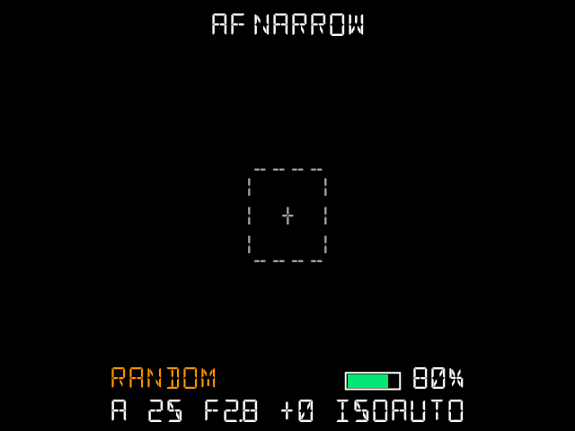
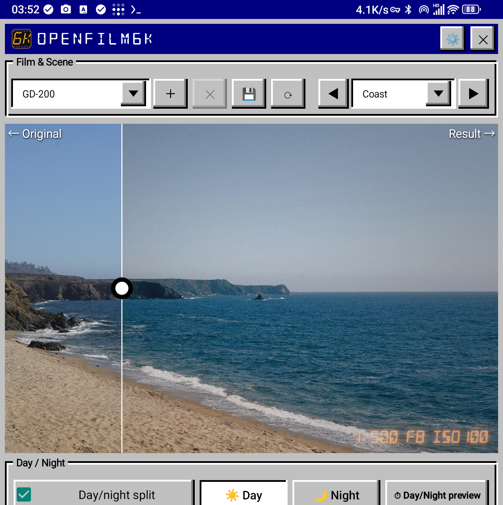
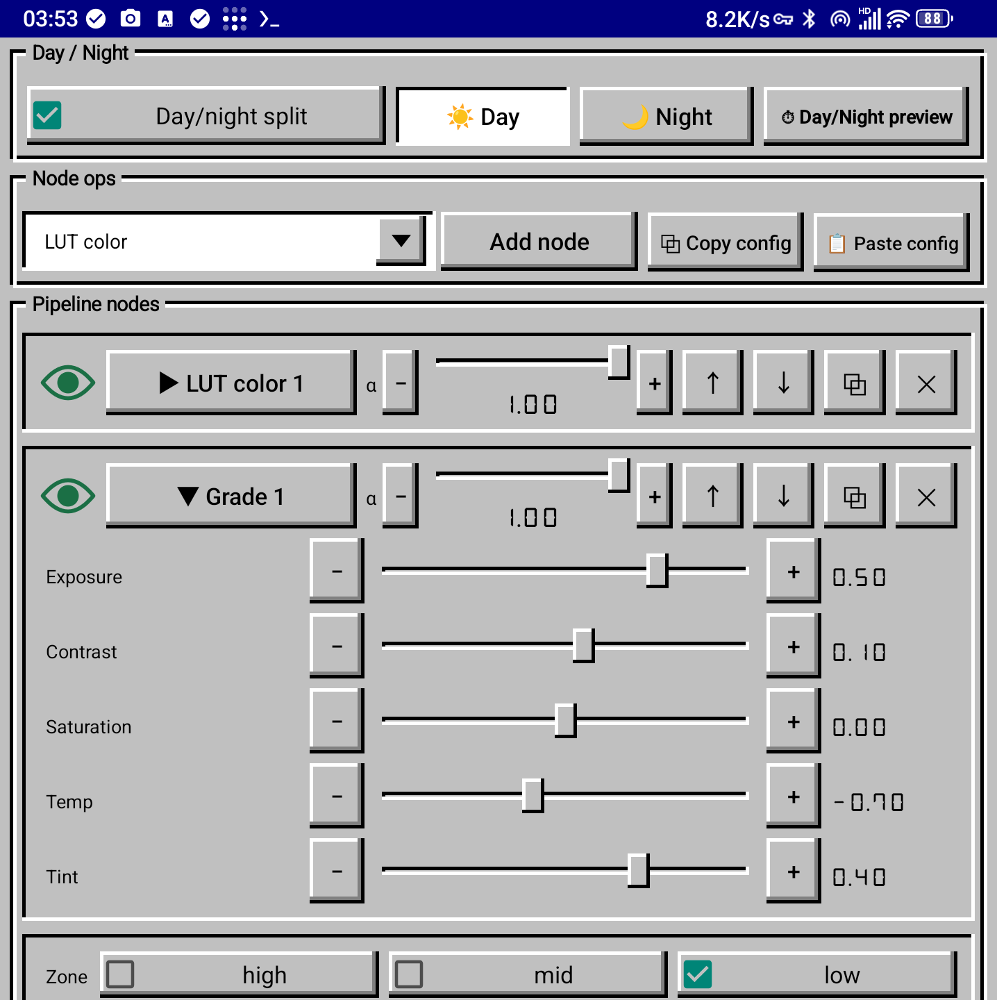
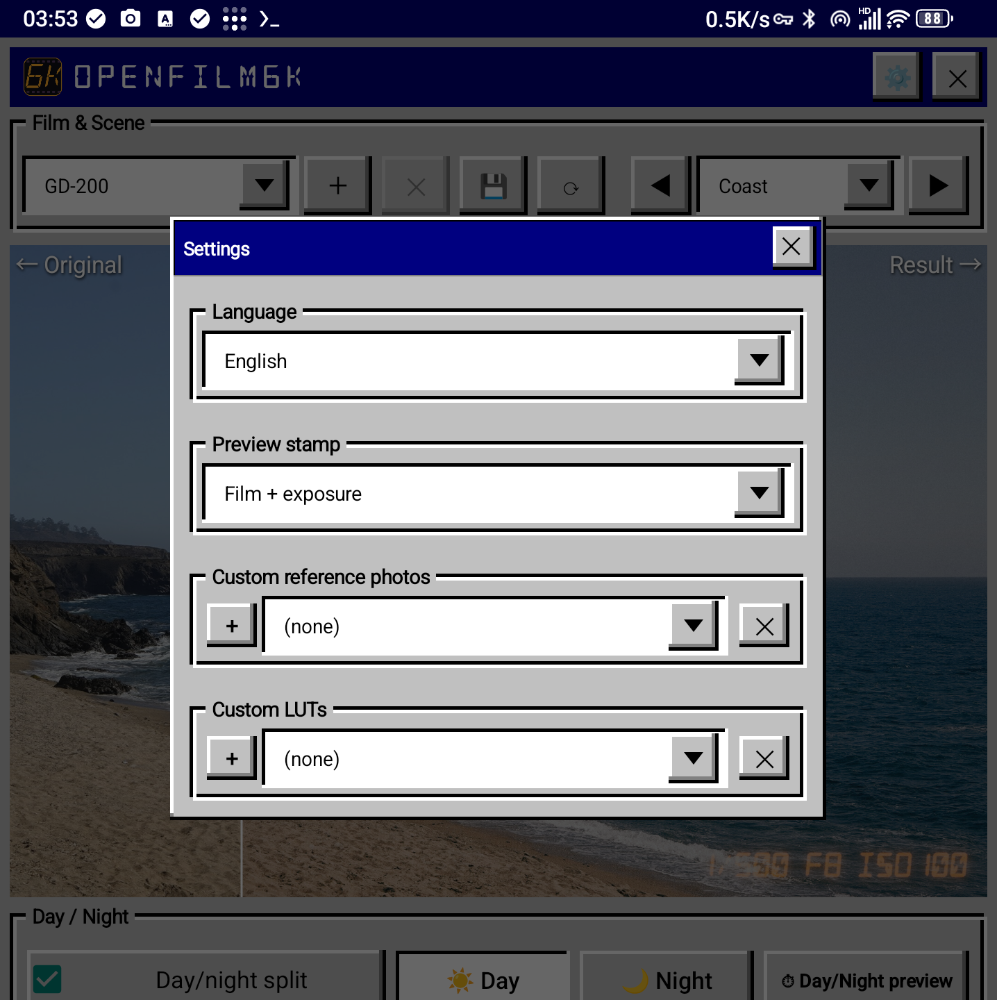

# OpenFilm6K

**专为索尼 A6000 相机打造的胶片模拟。**

OpenFilm6K 是一个开源的胶片模拟系统，面向能运行它的相机端 app 的索尼机型（α6000、α7 系列、NEX、RX100 III）：用相机拍摄，安卓手机自动渲染出胶片质感的成片——LUT 色彩、辉光、颗粒、暗角等全部可在节点编辑器里调整。任何入口（相机上传、文件夹监视、FTP、Rewind、Luma）收到的照片，都可以选择在手机端先按 ISO 或昼夜度条件降噪再调色，并可把原片原样另存一份。手机端还可以自行制作**水印模板**：文字、线条、矩形、照片位与相机品牌 Logo，拍摄时由相机叠加到照片上。

```
┌────────────┐   照片(HTTP)   ┌──────────────────────┐
│  A6000     │ ─────────────▶ │  安卓手机            │
│  相机端    │ ◀───────────── │  渲染主机 + 编辑器   │
│  (camera/) │  拉取卷列表    │  (host/)             │
└────────────┘                └──────────────────────┘
```

| 目录 | 内容 |
|---|---|
| `host/` | 手机端 app：渲染主机 + 节点图胶卷编辑器（Java + GLES3，另含原生 C++ 引擎） |
| `host/films/` | 内置胶卷：`pipelines/*.properties`（节点链）+ `luts/*.cube` |
| `camera/` | 相机端 app：拍摄、手动控制、上传到主机 |
| `host/assets/watermarks/` | 四套示例水印模板，首次启动安装 |
| `docs/screenshots/` | 使用截图 |

## 截图

### 相机端 app（A6000 上）



### 手机端 app（渲染主机 + 编辑器）

|  |  |  |
|---|---|---|

## 安装

**预编译安装包：** [github.com/phaseneko/OpenFilm6K/releases/latest](https://github.com/phaseneko/OpenFilm6K/releases/latest)
——手机端用 `OpenFilm6K-Host.apk`，相机端用 `OpenFilm6K-Camera.apk`。从源码构建见下方。

### 构建前提

- Android SDK（build-tools 30.0.3 与 36.0.0、android-28 平台）、NDK（arm64 clang 工具链 + 相机端用的 NDK r16 `ndk-build`）、JDK 8–17。
- 一台安卓手机（渲染主机）和一台可侧载应用的索尼 A6000（[PMCA 安装器](https://github.com/ma1co/Sony-PMCA-RE)，或 Wi-Fi `adb`）。
- 手机与相机在同一 Wi-Fi 网络（相机连接手机热点或共享网络，手机需是网关——相机据此找到主机）。

### 1. 构建 APK

```bash
# 手机端 — 生成 OpenFilm6K-Host.apk
cd host && bash build/build.sh

# 相机端 — 生成 OpenFilm6K-Camera.apk
cd camera && bash build.sh
```

### 2. 安装手机端

正常安装 APK 并启动一次。首次启动会：在 **8800** 端口启动渲染服务（状态栏常驻通知）、在 SD 卡创建数据目录。

### 3. 首次启动

首次启动涉及两项权限：

- **文件访问权限（必须）**——首次启动 app 会请求存储权限（Android 11+ 为「所有文件访问」；更早系统为普通存储权限）。请授予：没有它，内置胶卷库无法安装。
- **无障碍服务权限（可选）**——如果希望 app 常驻后台（作为相机的渲染主机使用时推荐），请在系统设置中开启：**设置 → 无障碍 → OpenFilm6K**。

授予文件访问权限后，打包在主机 APK 内的胶卷库（19 部卷的管线、LUT 与场景参考图）会自动安装：进度对话框把数据写入 `/sdcard/OpenFilm6K/`，结果对话框显示文件数量。安装采用**增量方式**：只写入缺失的文件，已有的修改与自建卷会原样保留。升级 APK 后可在**设置 → 重新安装数据**补入新增文件（同样的进度对话框，同样增量）。

### 4. 安装相机端

把 `OpenFilm6K-Camera.apk` 侧载到相机（[PMCA 安装器](https://github.com/ma1co/Sony-PMCA-RE)，或 `adb connect <相机IP>:5555 && adb install -r OpenFilm6K-Camera.apk`）。相机端**无需任何本地胶卷资产**——卷列表运行时从手机拉取，照片上传到手机渲染。

> 注：相机 SD 卡文件系统（索尼 FuFsys）只允许 app 写入既有目录。app 会把日志（`LOG.TXT`）写入第一个可写目录（`OpenFilm6K`、`DCIM/OpenFilm6K`、`DCIM`）。

## 相机端使用说明

相机端完全用相机物理按键操作（无触屏）。

### 启动与连接

先将相机连接到运行手机端 app 的手机的热点。启动后 app 加入网络、ping 手机主机（`:8800`）、拉取卷列表并显示取景画面。HUD 显示当前卷、曝光、电量与对焦状态。

### 按键表

各机型可用的动作一致，只是承载它的实体键不同：**横向为机型，纵向为按键。**

| 按键 | α6000 | α7 系列 | NEX 系列 | RX100 III |
|---|---|---|---|---|
| 快门半按 | 自动对焦（中央/点） | 自动对焦 | 自动对焦 | 自动对焦 |
| 快门全按 | 拍摄 → 上传手机渲染 | 拍摄 → 上传手机渲染 | 拍摄 → 上传手机渲染 | 拍摄 → 上传手机渲染 |
| 上 下 左 右 | 移动高亮（模式 / 快门 / 光圈 / ISO / EV / 选卷） | 移动高亮 | 移动高亮 | 移动高亮 |
| 中键 | 切换相机模式（P→A→S→M）；选卷列表里装载高亮卷 | 切换相机模式；选卷列表里装载高亮卷 | 确认 / 切换相机模式；选卷列表里装载高亮卷 | 切换相机模式；选卷列表里装载高亮卷 |
| Fn | 打开选卷列表 | 打开选卷列表 | 短按：打开选卷列表 · 长按：在收藏卷间切换 · 列表内：切换收藏标记 | 打开选卷列表 · 列表内：切换收藏标记（不关闭菜单） |
| AEL | 短按：进出对焦区域调整 · 长按：锁屏（3 秒倒数，任意键唤醒） | 短按：对焦区域调整 · 长按：锁屏 | 「软键 A」短按：对焦区域调整 · 长按：锁屏 | — |
| C1 | 按住 + 转盘：在收藏卷间切换；列表内：切换收藏标记 | 按住 + 转盘：在收藏卷间切换；列表内：切换收藏标记 | —（已并入 Fn） | — |
| C2 | 短按：打开水印与后期菜单 · 长按：切 LCD/EVF 显示模式 | 短按：打开水印与后期菜单 · 长按：切 LCD/EVF 显示模式 | 「软键 B」短按：打开菜单 · 长按：切 LCD/EVF 显示模式 | 短按（删除键）：打开菜单 · 长按：切 LCD/EVF 显示模式 |
| C3 | — | 快速切换对焦区域模式 | — | — |
| C4 | — | 同 C2 | — | — |
| MENU | 退出 app | 退出 app | — | — |
| PLAY | — | — | 退出 app | 退出 app |
| 前转盘 | — | 选卷 | — | — |
| 后转盘 | 曝光补偿（EV） | 曝光补偿（EV） | 曝光补偿（EV） | —（无后转盘） |
| 波轮 | 调整当前高亮参数 | 调整当前高亮参数 | 调整当前高亮参数 | 调整当前高亮参数 |
| 变焦拨杆 | — | — | — | W/T：光学变焦（广角 / 长焦） |

对焦调整状态下，**中央键**循环切换机身支持的测光模式（RX100 III 为中央键长按），HUD 显示当前模式。

水印菜单（C2 / 软键 B / RX100 删除键，短按）分两列：左列为水印与边框模式，右列为后期处理。状态栏以符号显示：*（空）* 无 · **D** 日期 · **E** 曝光 · **DE** 日期+曝光 · **B** 白卡边框 · **X** 四联拼 · **F** 卷名 · **FE** 卷名+曝光 · **USR** 自定义模板。手机端制作的模板排在左列最前。曝光 = 快门 / 光圈 / ISO，如 `1/60 F2.8 ISO400`。

- NEX 系列与 RX100 III 没有 MENU 键，按 `播放键` 退出 app（由固件处理）；NEX 的 C1 功能并入 Fn。
- RX100 III：没有后转盘（滚轮调整当前高亮参数），也没有 AEL / C1 / C3 / C4。因此**对焦区域调整移到中央键**（短按进出，长按对焦点回中；调节中方向键移动对焦点、滚轮切换 AF 区域模式、C1 退出并跳到胶卷行）。锁屏与 C1 收藏模式仍不可用；删除键充当 C2，W/T 拨杆驱动光学变焦。照片格式请保持 JPEG（不支持 RAW；app 会自动切回 JPEG，仅对 app 生效，不会改变相机本身的设置）。
- `MOVIE` 由相机固件先于 app 处理，不映射。

### 选卷列表（FN）

列表包含 `random`、`favorite` 与从手机拉取的全部卷。`>` 是光标，`*` 是已装载的卷。中键装载卷，之后的拍摄默认使用它。C1（NEX 系列与 RX100 III 为 Fn）切换收藏标记。

### 拍摄流程

全按快门：对焦 → 拍摄 → 照片连同所选卷与水印模式 POST 到手机（`/ingest`）→ 手机按该卷的管线渲染 → 成片进入相册 **OpenFilm6K**（`DCIM/OpenFilm6K`）。手机状态栏通知同步更新：左侧成片缩略图，右侧卷名、曝光参数（如 `1/125s F3.5 ISO400`）与拍摄时间——点击通知直接在相册中打开该照片。

手机不可达时，原片保留在相机 SD 卡，重连后自动续传。

## 手机端使用说明

### 桌面与首次启动

启动 OpenFilm6K 即进入编辑器。桌面区域有应用图标、一行简介和作者/链接信息。

### 编辑器

编辑对象是**卷的管线**：每个卷是一条节点链，每个节点是一步处理。

- **胶卷与场景组** — 卷选择框、`新建卷`（空白或复制当前卷，名称任意语言）、`删除卷`（仅自建卷，官方卷锁定）、`保存到卷`、`重读`，以及场景选择（系统场景 + 自己导入的参考图）。
- **白天夜晚组** — 一个卷可带**两套标定**：`白天夜晚分离` 把当前参数复制为日/夜两份（☀/🌙 选项卡分别编辑）；保存后主机在渲染时自动选择；`⏱ 昼夜预览` 对比两份效果；`昼夜度` 行给出当前照片偏日/偏夜的估计。
- **节点操作组** — `添加节点`（LUT 颜色 / 调色 / 辉光 / 颗粒 / 暗角 / 锐化 / 叠层 / 偏色）、`⧉ 复制配置` / `📋 粘贴配置`（整条链）、节点显隐切换、节点删除、每个节点的参数滑杆。
- **参数** — 曝光、对比、饱和、色温/色调、暗部/中间调/高光、辉光阈值与半径、颗粒尺寸/单色、暗角范围、叠层混合与缩放、色相预设等，全部滑杆调节。
- **设置对话框（⚙）** — 导入**自定义参考图**（jpg）与**自定义 LUT**（`.cube`）、删除、切换**语言**（10 种）、预览**水印**样式。
- **预览** — 主视图左边原图、右边成片，拖动分割线对比。标注模式：在图上拖框添加备注。

### 水印模板

**水印模板编辑器**用于自行制作水印模板：一块画布里包含照片位、文字、线条、矩形与相机品牌 Logo，每个元素可单独设置颜色、混合方式、不透明度、投影与柔边/锯齿边缘。内置四套示例模板，模板列表、当前使用的模板与相机端菜单顺序一致。

品牌 Logo 不随包分发：第一次需要时编辑器会提示下载（走你自己的网络，带下载进度条）；之后 Logo 按照片 EXIF 的品牌自动匹配，也可以逐个元素手动切换。

### 监视模式

监视手机上的目录，落入其中的照片会被渲染——不需要相机端 app。在对话框里勾选 **开启监视模式**，
再选择胶卷、水印与边框、后期处理；收到的新文件与相机端拍摄的照片同样渲染，并出现在通知里。
监视目录可逐个添加，另有两个快捷按钮填入常用位置：相机目录与 **LUMIX Lab** 保存目录。
半格、双重曝光这类成对模式会等待第二张再渲染。

### Luma 模式

适用于通过 **Lumix Sync** 与手机配对的松下机型：相机自己开一个 Wi-Fi 热点，手机从中拉取新照片。

1. 在相机上打开 Wi-Fi 菜单并启动热点：**Wi-Fi → Wi-Fi 功能 → 新连接 → 遥控拍摄与查看**
   （各机型措辞略有差异）。相机会在屏幕上显示它广播的网络名与密码。
2. 在手机端的 Luma 模式里原样填入该网络名与密码，然后点 **传输**。
3. 手机会连入相机网络，拉取上次传输之后的新照片，按相机端照片的方式渲染，结束后自动恢复
   原来的网络——传输期间手机处于离线状态。
4. 进度条与计数显示已传输的张数；显示 **无新照片** 表示卡上没有更新的文件。

使用 **Lumix Lab** 的新机型改为把照片交给该 app：把照片保存到手机上的 LUMIX Lab 目录，然后用
**监视模式** 配合「一键添加 LUMIX Lab 保存目录」——每个新文件都会同样被渲染。

### 通知照片收件箱

每次渲染成功，常驻通知更新为：左侧成片缩略图 + 卷名 + 曝光参数 + 拍摄时间，点击在系统相册打开该照片。

### FTP 模式（无法运行相机端 app 的机型）

不支持 PlayMemories 相机 app 的机身也能用这些胶卷：照片通过 **FTP** 上传，手机端把每一张都当作相机端拍摄的照片处理。

- 打开标题栏里的 FTP 按钮（在监视模式按钮左侧），或在对话框里开启 **FTP 模式**。对话框显示手机地址、端口（2121）、用户名与密码，以及和监视模式相同的胶卷 / 水印与边框 / 后期处理选择器，另有刷新按钮更新地址。
- 在相机上启用 `FTP 传输功能`，把上面的值填进它的服务器设置（被动模式、拍摄后自动上传）。
- 支持索尼 FTP 传输的机型包括 A1、A9 II、A7S III、A7 IV、A7R V、A7C II、A7C R、A6700、FX3、FX30 与 ZV-E1。
- 端口用 2121 是因为 21 需要 root 权限；相机端填同一个端口。
- 相机请保持普通彩色风格：黑白风格会烘焙进文件，无法再次调色。

### Rewindpix 相机（Rewind 模式）

原厂 Rewindpix PS135 固件不含手机端同步所需的功能。每次发布都附带一个小脚本，用**你自己
的**官方固件派生出该版本；脚本只保存差异，不随包分发任何官方固件。

手机端的 Rewind 模式负责把胶卷同步到该相机：开启 **Rewind 同步**，填好三个胶卷槽位与三个
水印 + 后期组合，并设置机身显示的名称（相机显示名最多 10 个大写字符，组合显示名最多 8 个）。
相机连到手机热点后设置会自动下发；**立即同步** 重新下发，**拉取全部照片** 取回卡上全部照片，
**刷新** 重新搜索相机，面板显示相机状态、上次同步与传输进度。

1. 从发布页下载 `patch_rewindpix.py`，并准备好你自己的官方 1.2.1D 固件文件（`FW_X94A.bin`）。
2. 安装 Python 3 后运行 `python3 patch_rewindpix.py FW_X94A.bin`。脚本会逐字节校验官方文件，
   不符合就直接拒绝，通过后输出 `FW_X94A_patched.bin`。
3. 把该文件以短名 `FW_X94A.BIN` 放到相机 SD 卡根目录，开机后相机会自行安装。卡上随后出现
   `HFS43.TXT` 即表示新版本已在运行。
4. 让相机知道连哪个网络：在 SD 卡根目录放一个纯文本 `wifi.txt`，两行——第一行手机热点名称
   （2.4 GHz），第二行热点密码（最多 26 个字符），例如：

   ```
   MyPhoneHotspot
   thepassword
   ```

   没有这个文件时相机会留在自己的 AP 模式；把 `wifi.txt` 改名或删除后重启即可回到 AP 模式。
5. 开机后长按 Wi-Fi 键，让它连到手机热点。手机端开启 **Rewind 模式** 后会自动下发胶卷、
   水印与后期设置，照片也按同样方式回传。
6. 请保留官方固件文件：用同样的方式拷到卡上即可恢复相机。

### 胶卷

内置一系列模拟胶卷（CV-250、CV-500、ET-100、ET-64、PR-100、CC-200、CS-800T、EV-500、FC-400、GD-200、LK-200、NC-200、PAN-100、PI-100、PT-400、PX-I、PX-II、RF-400、RF-800、SP-200、UM-400）。可以在编辑器里新建自己的卷，也可以在设置对话框中导入额外的 `.cube` LUT。

## 从源码构建 / 仓库结构

两个 app 均使用 `aapt`/`javac`/`d8`/NDK 流水线构建，无需 Gradle。参见 `host/build/build.sh` 与 `camera/build.sh`。

## 第三方组件

| 组件 | 用途 | 位置 | 许可 |
|---|---|---|---|
| [libjpeg-turbo](https://github.com/libjpeg-turbo/libjpeg-turbo) | 手机端原生渲染引擎的 JPEG 编解码 | `host/jni/turbo/` | BSD 风格 + IJG |
| [IJG libjpeg 9e](https://www.ijg.org) | 相机端的 JPEG 编解码 | `camera/jni/libjpeg/` | IJG License |
| [DSEG 字体](https://github.com/keshikan/DSEG) | HUD 与读数的 7/14 段显示屏字形 | `camera/assets/`、`host/res/raw/` | SIL OFL 1.1 |
| 其他字体（志莽行书、Great Vibes、得意黑、朱雀仿宋、Poppins、Playfair Display、Libre Baskerville、Lora、EB Garamond、Bebas Neue、Oswald、JetBrains Mono、Archivo Black、Liberation Sans、文泉驿正黑） | 水印模板排版 | `host/res/raw/` | SIL OFL 1.1（文泉驿：GPL-2.0 + 字体例外） |

完整许可文本见 [`THIRD_PARTY/`](THIRD_PARTY/)；每个内置字体的许可文本也可在 app 内查看。

## 许可证

GPL-3.0 — 见 [LICENSE](LICENSE)。

## 作者

NekoV — phaseneko@gmail.com — github.com/phaseneko

## 其他语言

[English README](README.md)
